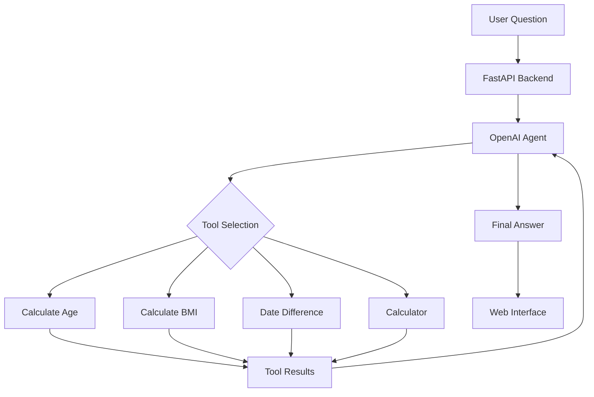

# Smart Utility AI Agent

An OpenAI-powered AI agent built with **LangChain, FastAPI, and Python**. The application understands natural-language questions, selects relevant custom tools, performs calculations, and returns answers with a transparent tool-execution trace.

## Features

- Natural-language interaction powered by OpenAI
- Automatic tool selection using LangChain
- Four custom Python tools
- Multiple tool calls within a single request
- Tool execution trace showing tool names, inputs, and results
- FastAPI backend with a simple web interface
- Modular and maintainable project structure

## Tech Stack

| Component | Technology |
|---|---|
| Programming Language | Python 3.11 |
| LLM | OpenAI |
| Agent Framework | LangChain |
| Backend | FastAPI |
| Frontend | HTML, CSS, JavaScript |
| Environment Configuration | python-dotenv |

## Custom Tools

The agent uses four custom Python tools:

| Tool | Description |
|---|---|
| `calculate_age` | Calculates age from a date of birth |
| `calculate_bmi` | Calculates BMI from height and weight |
| `calculate_date_difference` | Calculates the difference between two dates |
| `calculate_calculator` | Performs mathematical calculations |

Each tool is implemented in a separate Python file.

## Architecture



The OpenAI model determines which tool or tools are appropriate for the user's request. LangChain executes the selected tools and passes their results back to the agent.

## Project Structure

```text
smart-utility-ai-agent/
├── app.py
├── backend.py
├── template.py
├── tools/
│   ├── __init__.py
│   ├── age_tool.py
│   ├── bmi_tool.py
│   ├── date_difference_tool.py
│   └── calculator_tool.py
├── templates/
│   └── index.html
├── requirements.txt
├── .gitignore
├── LICENSE
└── README.md
```

### Main Components

- **app.py:** Handles HTTP requests using FastAPI.
- **backend.py:** Configures and executes the AI agent.
- **tools/:** Contains the custom calculation tools.
- **templates/index.html:** Provides the web interface.
- **template.py:** Generates the project structure programmatically.

## Installation

### 1. Clone the Repository

```cmd
git clone https://github.com/shk0224/Smart-utility-ai-agent.git
cd Smart-utility-ai-agent
```

### 2. Create a Python Environment

```cmd
conda create -n smartagent python=3.11 -y
conda activate smartagent
```

### 3. Install Dependencies

```cmd
python -m pip install -r requirements.txt
```

### 4. Configure OpenAI

Create a `.env` file in the project root.

```dotenv
OPENAI_API_KEY=your_openai_api_key_here
OPENAI_MODEL=gpt-4o-mini
```

Replace the placeholder with your OpenAI API key.

### 5. Run the Application

```cmd
python app.py
```

Open your browser:

http://127.0.0.1:8000

## Example Questions

### Age Calculation

John was born on March 15, 1995. Calculate his exact age as of November 7, 2026.

### BMI Calculation

John weighs 80 kg and is 175 cm tall. Calculate his BMI and identify his standard adult BMI category.

### Date Difference

How many days are there between November 7, 2026 and January 1, 2027?

### Mathematical Calculation

Calculate (250 * 12 + 500) / 7.

### Multiple Tool Calling

John was born on March 15, 1995. Calculate his exact age as of November 7, 2026, and calculate how many days remain from November 7, 2026 until January 1, 2027.

For this request, the agent can select both:

- `calculate_age`
- `calculate_date_difference`

The results are combined into a single response.

## API Endpoints

### GET /

Displays the web interface.

### POST /api/ask

Accepts a natural-language question and returns the agent's response.

Example request:

```json
{
  "question": "Calculate (250 * 12 + 500) / 7."
}
```

The response includes the final answer and tool-execution information when tools are called.

## Tool Execution Trace

The interface displays:

1. Selected tool name
2. Tool input arguments
3. Tool execution result
4. Final agent response

This provides visibility into how the agent processes requests.

## Security

- Store the OpenAI API key in `.env`.
- Exclude `.env` from Git using `.gitignore`.
- Never publish real API keys.
- Revoke exposed credentials before publishing.
- Do not upload local Git history containing secrets.


## License

See the LICENSE file for details.
